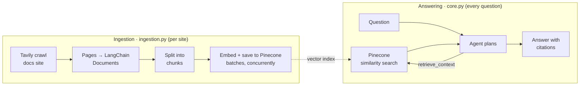

# Documentation Assistant

**[Try the app →](https://hudezz-docs-assistant.streamlit.app/)** · **[Project site →](https://hudezz.github.io/documentation-assistant/)**

Point it at any documentation site, then ask questions. An AI agent answers using only that site's pages and shows you the pages it used. The LangChain docs come built in.

Paste a URL and the app crawls it, chunks it and indexes it in Pinecone, in its own namespace. Then you ask a question. The agent decides what to search for, pulls the most relevant chunks of the docs out of a Pinecone vector database, and writes an answer with citations. If the docs don't cover it, it says so instead of guessing. A Streamlit UI animates each step while the agent works.

<!-- Add a GIF of the Live agent tab here: docs/demo.gif -->

## Features

- **Bring any docs site:** paste a URL (and optionally a focus, like "only the API reference"). It's crawled, indexed into its own Pinecone namespace, and added to the source picker. The public demo caps crawls at 25 pages, 3 sites per visit and 12 sites in total.
- **Agentic RAG:** a LangChain agent (`create_agent`) with a retrieval tool. The model chooses its own search queries and searches again when the first results aren't enough.
- **Answers with citations:** every answer links the documentation pages it came from.
- **Motion-graphics stage:** the whole architecture plays as a kinetic-typography sequence (Crawl → Chunk → Embed → Store → Search → Answer Complete) on its own stage beside the app, on every tab. The chat lives in a solid panel, so nothing moves behind the text you read or type. On phones the stage becomes a band above the chat. It shows real numbers from your index. When you ask a question, it cuts to the Search scene with your question, then shows your answer's real time and source count.
- **Live pipeline animation:** while the agent works, the UI lights up each step (plan, Pinecone search, write answer) as it really happens, streamed from the agent.
- **24/7 Live agent tab:** a nonstop replay of real recorded agent runs, with the actual search queries, pages and answers. It runs entirely in the browser, so it costs nothing to keep running.
- **Concurrent ingestion:** crawled pages are chunked, embedded and written to Pinecone in batches, all at the same time with `asyncio`.

## How it works



**Ingestion** (`ingestion.py`):
1. Tavily crawls the LangChain docs.
2. Each page becomes a `Document` with its URL as the source.
3. Pages are split into ~4,000-character chunks with 200 characters of overlap.
4. Chunks are embedded with `text-embedding-3-small` and written to Pinecone in batches, concurrently.

**Answering** (`core.py`): the agent gets one tool, `retrieve_context`, which returns the top matching chunks. It calls the tool as many times as it needs, then answers from those chunks only.

## Tech stack

| Part | Tool |
|---|---|
| Agent framework | LangChain 1.x (`create_agent`) |
| LLM | OpenAI `gpt-5.2` |
| Embeddings | OpenAI `text-embedding-3-small` (1536 dimensions) |
| Vector database | Pinecone (serverless) |
| Crawler | Tavily Crawl |
| UI | Streamlit, with custom HTML/CSS/JS animation |
| Package manager | uv |

## Project structure

```
.
├── ingestion.py           # crawl → documents → chunks → Pinecone (ingest_site)
├── core.py                # the agent: run_llm() and stream_llm(), per namespace
├── sources.py             # indexed sites = Pinecone namespaces; URL validation
├── evaluation.py          # test harness wrapper (evaluation suite in progress)
├── record_demo.py         # records real runs for the Live agent tab
├── logger.py              # coloured console logging
├── frontend/
│   ├── app.py             # Streamlit page (tabs, chat, sidebar)
│   ├── components.py      # renders the animation inside Streamlit
│   ├── demo_runs.json     # recorded runs replayed by the Live agent tab
│   ├── static/            # served by Streamlit at /app/static/
│   │   ├── background.js  # full-page motion graphics behind every tab
│   │   └── background.css # glass UI styling over the motion graphics
│   └── agent_viz/
│       ├── index.html     # pipeline animation markup
│       ├── style.css      # pipeline animation styles
│       └── script.js      # pipeline + 24/7 replay logic
├── site/                  # GitHub Pages landing page (index.html, site.css)
├── scripts/build_site.py  # builds the Pages site from site/ + frontend/
├── .github/workflows/     # deploys the site on push to main
└── .streamlit/config.toml # dark theme + static file serving
```

The backend (`core.py`, `ingestion.py`, `sources.py`) has no UI code; the frontend calls it through `stream_llm()`, `ingest_site()` and `list_sources()`.

## Getting started

**Requirements:** Python 3.11+, [uv](https://docs.astral.sh/uv/), and API keys for OpenAI, Pinecone and Tavily.

```bash
git clone https://github.com/hudezz/documentation-assistant.git
cd documentation-assistant
uv sync
```

Create a `.env` file in the project root:

```env
OPENAI_API_KEY=...
PINECONE_API_KEY=...
TAVILY_API_KEY=...
INDEX_NAME=document-assistant
```

### Create the Pinecone index

The index needs **1536 dimensions** and the **cosine** metric. Create it with the Python SDK, not the Pinecone console:

```python
from pinecone import Pinecone, ServerlessSpec

pc = Pinecone(api_key="...")
pc.create_index(
    name="document-assistant",
    dimension=1536,
    metric="cosine",
    spec=ServerlessSpec(cloud="aws", region="us-east-1"),
)
```

> **Why not the console?** Indexes created in the Pinecone console can come with a *document schema*. Those indexes only accept writes through Pinecone's newer documents API, and `langchain-pinecone` writes through the vectors API, so every write fails with a `400`. An index created with the SDK as shown above works.

### Run it

```bash
uv run ingestion.py                # 1. crawl the docs and fill Pinecone
uv run record_demo.py              # 2. (optional) record runs for the Live agent tab
uv run streamlit run frontend/app.py   # 3. open the app
```

You can also ask a single question from the terminal:

```bash
uv run core.py
```

## Deploy (Streamlit Community Cloud)

1. At [share.streamlit.io](https://share.streamlit.io), create an app from this repo with main file `frontend/app.py` and Python 3.11.
2. In **Advanced settings → Secrets**, add:
   ```toml
   OPENAI_API_KEY = "..."
   PINECONE_API_KEY = "..."
   TAVILY_API_KEY = "..."
   INDEX_NAME = "document-assistant"
   ```
Dependencies install from `requirements.txt`, which is generated from `uv.lock` (`uv export --no-hashes --no-dev --no-emit-project -o requirements.txt`).

## Known limitations

- **Small crawl by default.** `max_depth=3` with an "AI agents" instruction keeps the index small (around a dozen pages). Raise `max_depth` in `ingestion.py` for broader coverage.
- **Re-running ingestion creates duplicates.** Chunks don't have stable IDs yet, so clear the index before re-ingesting.
- **Some chunks are navigation menus.** Tavily sometimes returns a page's menu data along with its content, and those chunks aren't filtered out yet.

## Roadmap

- [ ] Stable chunk IDs and content hashes, so re-crawls only update changed pages
- [ ] Filter navigation and boilerplate chunks during ingestion
- [ ] Evaluation suite in LangSmith: retrieval hit rate, answer correctness, refusing out-of-scope questions
- [ ] Self-verifying answers: run generated code against installed library versions and self-correct with LangGraph
- [ ] Deploy a public demo

## License

Apache 2.0. See [LICENSE](LICENSE).
